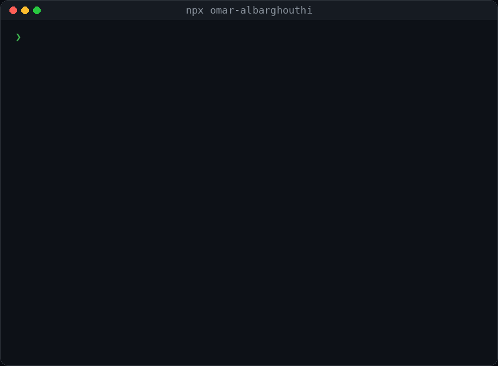

<p align="center">
  
</p>

<h1 align="center">npx omar-albarghouthi</h1>

<p align="center">My business card, in your terminal.</p>

```bash
npx omar-albarghouthi
```

It runs a short boot sequence, types out the card, then opens a menu:

| Key | Action |
|:--|:--|
| ↑ / ↓ (or j / k) | Move |
| Enter | Open NiceTable, browse projects, email me, open LinkedIn or GitHub |
| q / Esc | Quit |

Options: `--static` prints the card without animation, `--no-color` turns colors off. It also stays static when piped or in CI.

## How it's built

- **Zero dependencies.** One Node file, so `npx` starts in a second.
- Truecolor gradient with a 256-color fallback, and `NO_COLOR` support.
- Raw-mode keyboard handling for the menu, and URLs opened through the OS (`open`, `xdg-open`, `start`).
- Falls back to a frameless layout on narrow terminals.

Works on macOS, Linux and Windows Terminal with Node 14 or newer.

## About me

AI Engineer building LLM apps and measuring whether they work. Open to AI and software engineering roles in Jordan, the Gulf and remote.

[GitHub](https://github.com/ThisisOmar-here) · [LinkedIn](https://www.linkedin.com/in/omar-albarghouthi) · omarbarghouti505@gmail.com

MIT License
